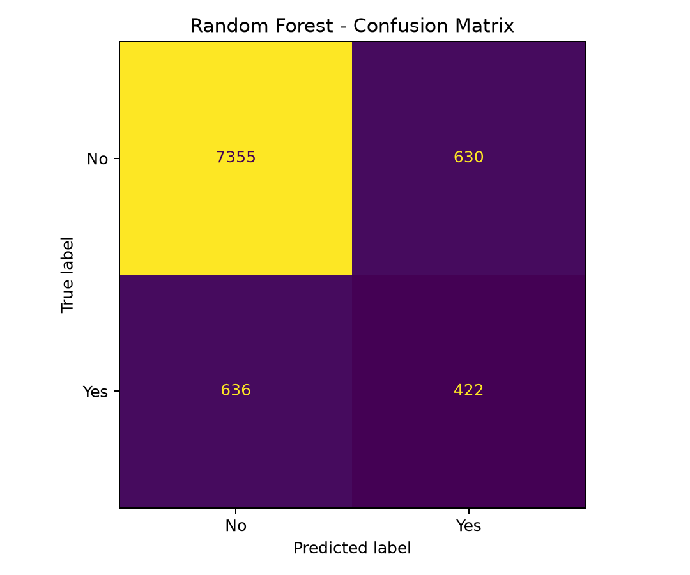
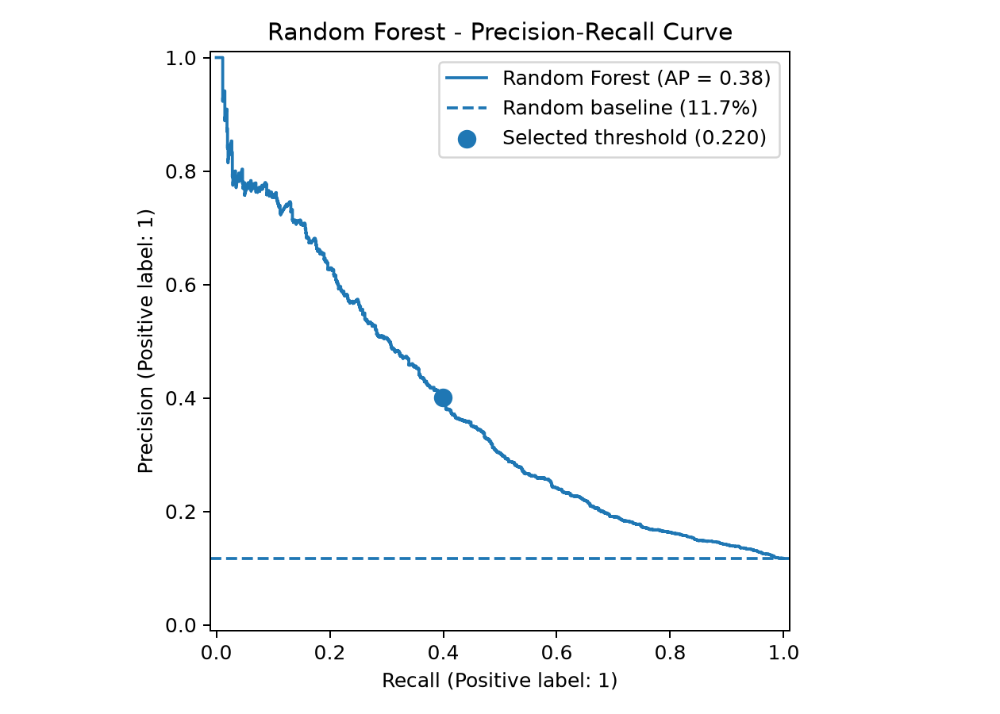

# Bank Marketing — Machine Learning Classification

An end-to-end machine learning project that predicts whether a bank customer will subscribe to a term deposit, using information available **before a call in the current marketing campaign**.

Built with the [UCI Bank Marketing dataset](https://archive.ics.uci.edu/dataset/222/bank+marketing), the project covers exploratory data analysis, preprocessing, model benchmarking, cross-validation, threshold selection, held-out evaluation, and inference with a saved model.

## Project Goals

- Explore a real-world classification dataset and investigate data quality.
- Design a prediction task that avoids using information from the current marketing call.
- Build reproducible preprocessing and training pipelines.
- Compare a majority-class baseline with Logistic Regression and Random Forest.
- Evaluate an imbalanced classification problem using appropriate metrics.
- Save the fitted model and generate predictions for new customer records.

## Dataset

**Source:** [UCI Machine Learning Repository — Bank Marketing](https://archive.ics.uci.edu/dataset/222/bank+marketing)

This project uses the **bank-full** dataset:

- **45,211 records** and **16 original input features**.
- **Target:** `subscribed` (`yes` or `no`).
- **Positive class (`yes`):** 11.70% of records.
- **Final feature set:** 11 features after excluding five fields.

The target is imbalanced: predicting `no` for every customer already achieves approximately 88.3% accuracy. Therefore, accuracy alone is insufficient to assess the usefulness of a model.

### Exploratory Data Analysis

The analysis in [`notebooks/01_eda.ipynb`](notebooks/01_eda.ipynb) examines class balance, categorical variables, numerical distributions, missing values, and previous campaign history.

Notable findings include:

- The positive class represents only 11.70% of customers.
- Some categorical fields contain missing or unknown information.
- `pdays = -1` represents customers without a previous contact and requires special handling.
- Account balance is strongly right-skewed and contains negative values and outliers.

## Methodology

### 1. Feature selection and data leakage prevention

The intended prediction point is **before a contact in the current campaign**. To keep the model aligned with this use case, these features are excluded:

`duration`, `campaign`, `contact`, `day_of_week`, `month`

In particular, call duration would not be known before the call. The other exclusions are conservative choices for this project's prediction scenario; their availability could differ in another operational setting.

### 2. Train/test split

The data is divided into **80% training (36,168 records)** and **20% testing (9,043 records)** using a stratified random split (`random_state=42`). The test set is kept separate from model selection and threshold tuning.

### 3. Preprocessing

Preprocessing is implemented with scikit-learn `Pipeline` and `ColumnTransformer`:

- **Numerical features:** median imputation, missing-value indicators, and standard scaling.
- **Categorical features:** constant-value imputation (`unknown`) and one-hot encoding.
- **Unseen categories:** handled by `OneHotEncoder(handle_unknown="ignore")`.

The preprocessing is fitted separately within each cross-validation training fold, preventing information from the validation fold from leaking into the transformations.

### 4. Model evaluation and selection

Three models are compared using **5-fold stratified cross-validation** on the training set:

- `DummyClassifier` (majority-class baseline)
- `LogisticRegression`
- `RandomForestClassifier`

We consider accuracy, precision, recall, F1-score, ROC-AUC, and **Average Precision (AP)**, used here as the precision-recall summary metric.

For Random Forest, out-of-fold probabilities are used to select a classification threshold that maximizes F1-score on the training data. The selected threshold is then fixed for the held-out test evaluation.

## Results

### Cross-validation comparison

The following results are **mean 5-fold cross-validation scores on the training set**, using the default classification threshold of 0.5 for Logistic Regression and Random Forest:

| Model                   |   Accuracy |  Precision |     Recall |   F1-score |    ROC-AUC | Average Precision |
|-------------------------|-----------:|-----------:|-----------:|-----------:|-----------:|------------------:|
| Majority-class baseline |     88.30% |      0.00% |      0.00% |      0.00% |     0.5000 |            0.1170 |
| Logistic Regression     |     89.25% |     66.83% |     16.12% |     25.96% |     0.7119 |            0.3464 |
| **Random Forest**       | **89.36%** | **68.46%** | **16.71%** | **26.85%** | **0.7268** |        **0.3743** |

Random Forest achieved the highest ROC-AUC and Average Precision of the evaluated models.

### Threshold selection

With the default 0.5 threshold, Random Forest identifies relatively few subscribers. Using out-of-fold training predictions, a threshold of **0.2201** was selected to balance precision and recall by maximizing F1-score.

The F1-score measured on those same out-of-fold predictions was **40.52%**. Because the threshold was selected using those predictions, this score may be optimistic; the held-out test results below provide a more independent assessment.

### Final held-out test results

The fitted Random Forest pipeline was trained on all 36,168 training records and evaluated on the **9,043 previously held-out test records**, using the selected threshold of **0.2201**.

| Metric            | Test result |
|-------------------|------------:|
| Accuracy          |      86.00% |
| Precision         |      40.11% |
| Recall            |      39.89% |
| F1-score          |      40.00% |
| ROC-AUC           |      0.7324 |
| Average Precision |      0.3823 |

**Confusion matrix (test set):**

| Actual \\ Predicted |    No | Yes |
|---------------------|------:|----:|
| No                  | 7,355 | 630 |
| Yes                 |   636 | 422 |

The model correctly identifies **422 of the 1,058 actual subscribers** in the test set. Its lower accuracy at the selected threshold is an intentional trade-off: it detects substantially more subscribers than a majority-class classifier, which never predicts `yes`.

### Evaluation figures





These figures are generated by `src/plot_results.py` using the saved model and the held-out test split.

## Project Structure

```text
bank-marketing-ml/
├── data/raw/                 # Downloaded dataset (not tracked by Git)
├── notebooks/
│   └── 01_eda.ipynb          # Exploratory data analysis
├── src/
│   ├── download_data.py     # Download and save the dataset
│   ├── data_loader.py       # Load data and create train/test split
│   ├── preprocessing.py     # Build preprocessing pipeline
│   ├── evaluation.py        # Model metrics and threshold analysis
│   ├── train.py             # Compare, train, evaluate, and save model
│   ├── predict.py           # Example inference on a new customer
│   └── plot_results.py      # Generate evaluation charts
├── models/                  # Local model artifacts (not tracked by Git)
├── reports/figures/         # Evaluation plots
├── .gitignore
├── LICENSE
├── README.md
└── requirements.txt
```

## Getting Started

### Requirements

- Python 3.12
- Git
- [`uv`](https://docs.astral.sh/uv/) (recommended)

The steps below use a Linux/WSL terminal.


### Installation

Clone the repository and navigate to the project directory:

```bash
git clone https://github.com/GustavoFerreira24/bank-marketing-ml.git
cd bank-marketing-ml
```

Create a Python 3.12 virtual environment:

```bash
uv venv --python 3.12 .venv
```

Install the locked dependencies:

```bash
uv pip sync --python .venv/bin/python requirements-lock.txt
```

### Run the project

```bash
# 1. Download and prepare the dataset
python src/download_data.py

# 2. Run cross-validation, train the final model, and save it
python src/train.py

# 3. Generate predictions for an example customer
python src/predict.py

# 4. Create evaluation figures
python src/plot_results.py
```

The training script saves a fitted model and its selected threshold to `models/random_forest.joblib`. Run training before the prediction and plotting scripts. The dataset and serialized model are generated locally rather than committed to the repository.

## Limitations and Future Work

This project prioritizes a **complete, understandable, and reproducible ML workflow** over exhaustive performance optimization. Potential extensions include:

- Tuning hyperparameters and benchmarking gradient boosting methods.
- Using business costs or campaign constraints to select a decision threshold instead of optimizing F1-score alone.
- Assessing probability calibration and model interpretability or feature importance.
- Testing generalization across time or changing customer populations; the current split is random rather than temporal.
- Refining the handling of previous-campaign information and validating feature availability against a real deployment scenario.

The model is a learning and portfolio exercise, **not a production-ready banking decision system**. The test set was used for final evaluation, not further model selection.

## Acknowledgements

Dataset: [Bank Marketing — UCI Machine Learning Repository](https://archive.ics.uci.edu/dataset/222/bank+marketing).

Moro, S., Cortez, P., & Rita, P. (2014). *A Data-Driven Approach to Predict the Success of Bank Telemarketing.*

## License

The project source code is released under the [MIT License](LICENSE). The original UCI dataset is provided under **CC BY 4.0** and remains subject to its own license and attribution requirements.
